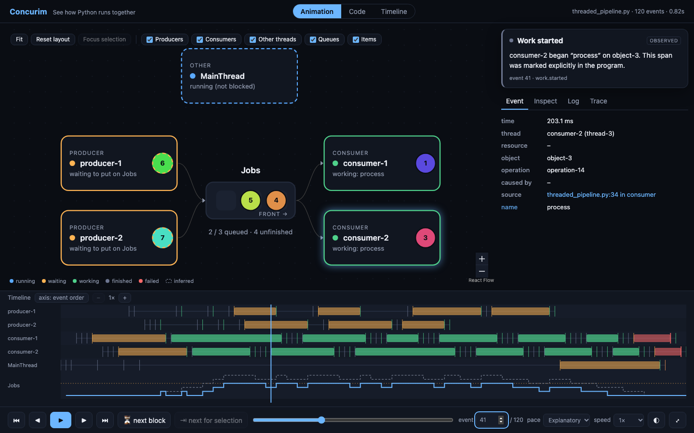

<p align="center">
  
</p>

# Concurim

**See how Python runs together.**

Concurim records what your threads and asyncio tasks actually do (queues,
locks, semaphores, thread pools), then replays it as an interactive
animation: which worker is running, which is blocked and why, who holds each
lock, where every item is, and what each event means.



*A real recording of [`src/concurim/samples/threaded_pipeline.py`](src/concurim/samples/threaded_pipeline.py)
(event 41 of 120): two producers and two consumers share a queue of capacity 3.
Items 5 and 4 are queued (the front is on the right), consumer-1 is working on
1 and consumer-2 on 3, and both producers are still inside a blocked `put`
with items 6 and 7 in hand.*

> **Status: 0.1 (alpha).** Threads, `queue.Queue`, locks, semaphores,
> `ThreadPoolExecutor`, `ProcessPoolExecutor` and asyncio (tasks, queues,
> locks), recorded automatically or with Concurim-managed primitives.
> Events, conditions, `asyncio.TaskGroup`, `multiprocessing` (`Pool`,
> `Process`), a lineage browser, a resources layout, run comparison
> (`concurim compare`) and video export (`concurim export`) are included.
> Barriers are planned. See
> [what is and is not observed](docs/limitations.md).

## Try it

```bash
git clone <this repo> && cd concurim
uv sync
uv run concurim             # opens the home screen in your browser
uv run concurim demo        # records a real threaded pipeline and opens it
```

Once published (not yet): `uvx concurim`, `uv tool install concurim`.

On the home screen you can:

- **Drop a `.concurim` trace** (or open an example): it opens immediately and
  nothing is executed.
- **Drop a `.py` file or a project folder**, pick the entry point, interpreter,
  arguments and observability level, review the plan, then click
  **Record execution**. The finished recording opens automatically. A dropped
  program is *never* run until you click, and it runs with your user's
  permissions (there is no sandbox).

### Compare and export

```bash
uv run concurim compare gil.concurim free-threaded.concurim
uv run concurim export run.concurim -o clip.mp4 --view code --events 5:40
```

`export` also writes `.webm`, `.gif`, or a directory of PNG frames
(`--hide explanation|timeline`, `--size 1080p`, `--no-footer`). It needs a
Chrome-family browser and ffmpeg (`pip install 'concurim[video]'` bundles
one); the picture is deterministic for a given trace. It only loads the
trace; it never runs your program.

### Observability levels

| Level | What it does | You see |
| --- | --- | --- |
| Basic (default) | Nothing patched | Only what you instrument |
| Threads | Records `threading.Thread` start/run/finish | Thread lifecycles |
| Threads + queues | Also swaps `queue.Queue` while recording (reversed on exit) | Queue operations and item identity |
| + locks, semaphores, pools | Also swaps `threading.Lock/RLock/Semaphore/BoundedSemaphore` and `ThreadPoolExecutor` / `ProcessPoolExecutor` | Who holds or waits for each lock, permits, tasks flowing through a pool |
| + asyncio | Also patches task creation/stepping and `asyncio.Queue/Lock/Semaphore` | Tasks as actors, awaits on queues and locks |
| Managed | You use `TracedQueue` / `TracedLock` / `TracedThreadPoolExecutor` / ... | Full detail incl. lineage (`derived_from`) |

Anything a level cannot see is shown as unavailable, never guessed. Choose with
`concurim record --auto none|threads|queues|sync|asyncio`. Only objects your
own code creates are traced, and only while recording
([details and caveats](docs/limitations.md)).

## Record your own program

For full detail (item identity, work spans), use the traced primitives:

```python
import queue
from concurim import TracedQueue, TracedThread, work

jobs = TracedQueue(maxsize=3, name="Jobs")


def worker():
    while True:
        try:
            item = jobs.get_with_id()  # value + logical object id
        except queue.ShutDown:
            return
        with work("process", object_id=item.object_id):  # observed work span
            handle(item.value)
        jobs.task_done()


threads = [TracedThread(target=worker, name=f"worker-{i}") for i in range(2)]
...
```

Outside a recording they behave exactly like `queue.Queue` / `threading.Thread`.

```bash
uv run concurim record src/concurim/samples/threaded_pipeline.py          # -> threaded_pipeline.concurim
uv run concurim record -o run.concurim --include-source my_app.py arg1 arg2
uv run concurim view run.concurim
uv run concurim inspect run.concurim                           # metadata + coverage
```

Options go **before** the script; everything after the script path is passed to
your program unchanged. Or record from code:

```python
from concurim import record, TracedQueue

with record("trace.concurim"):
    jobs = TracedQueue(maxsize=5, name="Jobs")
    ...
```

When Concurim is installed as a standalone tool (`uv tool install`, `uvx`) it
runs in its own environment and cannot import *your* project's dependencies.
To record a project, install Concurim into the project
(`uv add --dev concurim`, then `uv run concurim record ...`).

## Using the viewer

| Action | How |
| --- | --- |
| Play / pause | `Space` or ▶ |
| Step forward / back | `→` / `←` (`Shift` = 10 events) |
| Beginning / end | `Home` / `End` |
| Speed | `[` `]` or the speed menu |
| Seek | scrub bar, event number box, or click/drag the timeline |
| Inspect | click a thread or task, a queue or pool, a lock, or an item token |
| Drag / zoom | drag nodes, scroll to zoom; layout is remembered. **Fit** / **Reset layout** in the toolbar, `f` fits |
| Views | **Animation** (understanding), **Code** (the animation beside the source: each busy worker's line is lit in its item's colour; needs `--include-source`) or **Timeline** (dense, technical); same position, click an event then *Show in animation* |
| Fullscreen | ⤢ in the transport bar or `z`; the playback controls stay, `Esc`, `z` or *Exit fullscreen* returns |
| Pacing | *Explain* slows down blocking events; *Real time* follows recorded gaps (optionally compressing idle time) |
| Jump | next blocking event, next event for the selection |
| Many workers | **Group workers** collapses groups of 4+ into one node (automatic above 24); repeating events in the **Log** fold into `×N` |
| Source | In **Event**, the source location opens **Code** on that line |

The explanation card describes the current event and labels anything inferred.
Dashed thread borders mean the state is *inferred* (for example "running, not
blocked"), solid borders mean it was observed.

## What you can trust

- Queue contents change only on recorded events, in true mutation order.
- *Queued* and *unfinished* are different numbers: a dequeued item leaves the
  queue but stays unfinished until `task_done()`.
- `task_done()` doesn't say which item finished; Concurim only attributes it
  when you pass `object_id=`, otherwise it labels the pairing as inferred.
- Truncated recordings, uninstrumented objects and unobservable behavior
  (CPU scheduling, the GIL) are stated in the trace and the UI.

## Privacy and security

Local only: the viewer binds `127.0.0.1`, has no telemetry or uploads, validates
traces on load (no pickle, no code execution), and serves source only from the
trace. Source and payload previews are **off by default**. A trace can contain
paths, thread names and, if enabled, code or data previews: review before
sharing. Recording changes timing. See [SECURITY.md](SECURITY.md).

## Cost

Measured on an Apple-silicon laptop, CPython 3.13 (`scripts/benchmark.py`):

| | |
| --- | --- |
| `TracedQueue` while not recording | ~2× a bare `queue.Queue` call (≈0.5 µs more) |
| Recording, detailed or light | ≈10 µs per put+get pair (≈20× a bare, work-free loop) |
| Memory while recording | ≈550 B/event (in-memory buffer) |
| Trace size | ≈19 B/event on disk (zip) |
| Load + replay | ≈1.5 s for 80k events |

Instrumentation overhead dominates only when threads do no real work; with real
work between queue operations it is usually negligible, but always re-measure.

## Development

```bash
uv sync
uv run pytest                      # unit, integration, concurrency tests
uv run ruff check . && uv run ruff format --check .
uv run ty check src
cd frontend && npm ci && npm test  # frontend logic tests
npx playwright install chromium && npm run e2e
scripts/build.sh                   # builds the viewer into the package, then uv build
scripts/smoke_wheel.sh             # installs the wheel into a clean venv and runs it
```

More: [architecture decision record](docs/adr/0001-architecture-and-reference-projects.md),
[trace format](docs/trace-format.md), [limitations](docs/limitations.md),
[contributing](CONTRIBUTING.md), [changelog](CHANGELOG.md).

MIT licensed.
